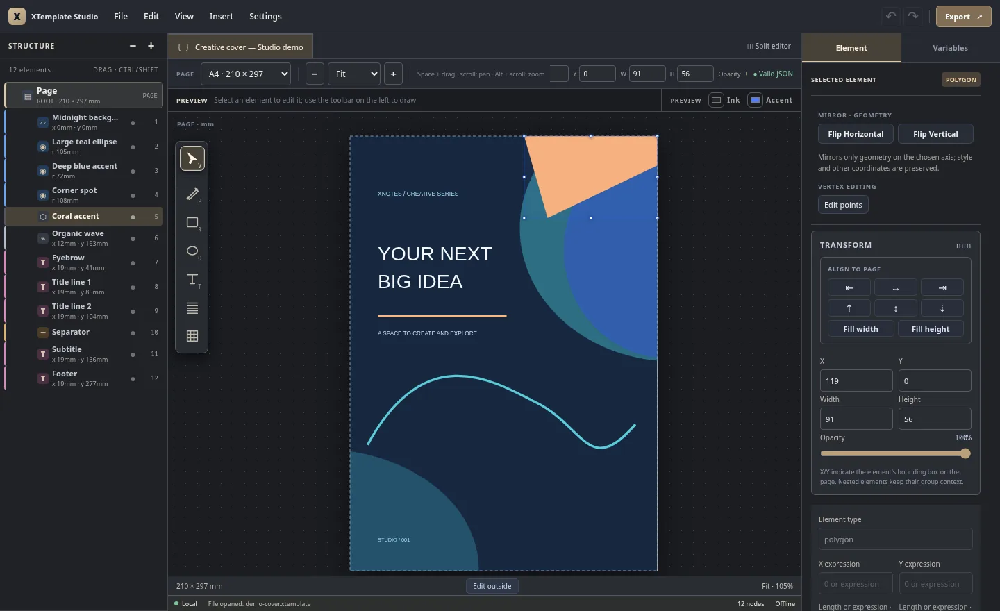
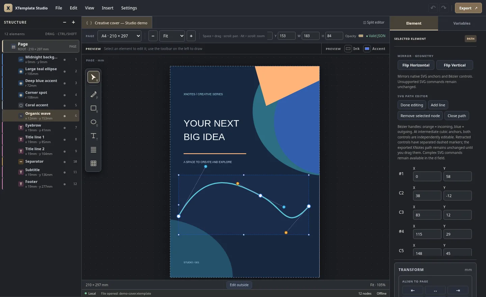
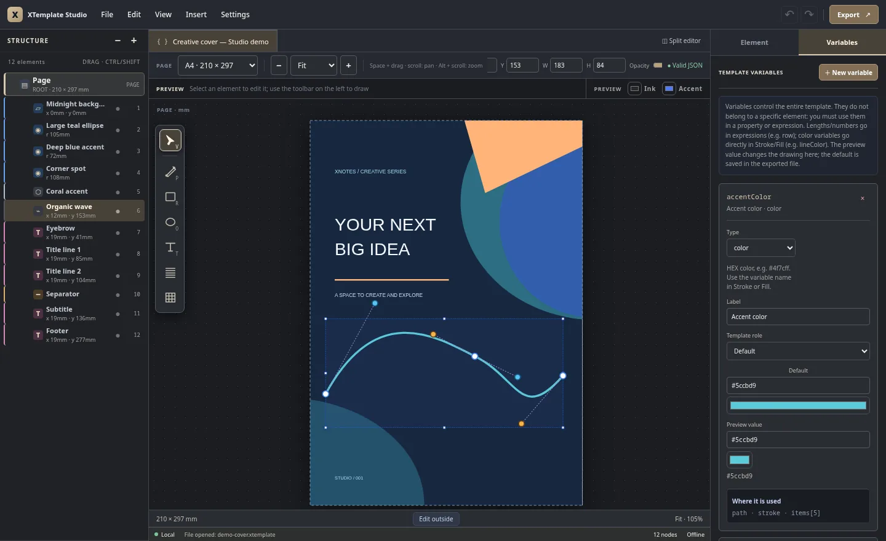

# XTemplate Studio

**A visual, offline editor for [XNotes Android](https://github.com/shardulvs/xnotes-android) `.xtemplate` files.** Design notebook pages, covers and reusable templates on your computer, then export them for XNotes. No account or cloud service required.

[](https://github.com/wesleydanieell/xtemplate-editor/actions/workflows/ci.yml)
[](https://github.com/wesleydanieell/xtemplate-editor/actions/workflows/windows.yml)
[](https://github.com/wesleydanieell/xtemplate-editor/actions/workflows/appimage.yml)
[](LICENSE)

> **Current release: [v0.1.0-alpha.6](https://github.com/wesleydanieell/xtemplate-editor/releases/tag/v0.1.0-alpha.6)** · Preview software; some advanced rendering may differ from XNotes Android.

## Preview



*Real Studio screenshots using a demo cover; no mockups.*

| SVG Path and Bézier editing | Color variables and live preview |
|:---:|:---:|
|  |  |

## Features

- **Visual canvas + JSON editor:** draw, inspect and edit native XNotes elements with undo/redo and optional split view.
- **Image covers and watermarks (development):** insert PNG/JPEG/WebP, adjust crop frames and image focus, then export a portable ZIP `.xtemplate`. Try the [bundled image-based examples](examples/README.md) or read the [image-package guide](docs/IMAGE_PACKAGES.md).
- **Pen and vector tools:** lines, polygons, polylines, Bézier paths, Hatch patterns, snapping, node editing and horizontal/vertical mirroring.
- **Layer organization:** nested groups, `repeat`, multi-selection, drag-and-drop in **Structure**, and alignment guides.
- **Cover design:** place shapes and control points outside the page; only the portion inside the sheet is rendered, while editing handles stay accessible.
- **Variables:** reusable lengths, numbers and colors, including color pickers and separate preview values.
- **Local by design:** create a blank document or start from bundled examples; export standard `.xtemplate` files without an online service.

## Install

Download the latest packages from **[GitHub Releases](https://github.com/wesleydanieell/xtemplate-editor/releases)**:

| Platform | Download | Notes |
|---|---|---|
| Windows x64 | `.exe` (recommended) or `.msi` | Tauri desktop app; uses WebView2. Installers are unsigned. |
| Linux x86_64 | `.AppImage` | Make executable with `chmod +x XTemplate*.AppImage`. |
| Windows / Linux / macOS | Portable `.zip` | Extract and serve locally using Python 3; no Node.js needed. |

For the portable ZIP, open the extracted `XTemplate-Studio` directory and run `./start.sh` on Linux, or run `python3 -m http.server 8765 --bind 127.0.0.1` (Windows: `py -3 -m http.server 8765 --bind 127.0.0.1`). Visit **http://127.0.0.1:8765/**. Do not open `index.html` directly with `file://`.

## Tests & development

Requires Node.js 18+ for development; browser tests require an installed Chromium-based browser.

```bash
npm ci
npm run check          # Syntax validation
npm test               # Unit and compatibility tests
npm run test:browser   # Real Chromium canvas/UI interactions
npm run package        # Build portable ZIP
```

If Chromium is not detected, set `XTEMPLATE_BROWSER_PATH` to its executable. GitHub Actions runs the browser suite and builds Linux and Windows packages. See [development notes](docs/DEVELOPMENT.md) and [contributing guidelines](CONTRIBUTING.md).

## Compatibility & docs

XTemplate Studio targets the [official `.xtemplate` specification](https://github.com/shardulvs/xtemplate), **not arbitrary SVG files**. Editor-only guides, handles and preview settings are not written into exported templates. There is currently no native gradient-fill support in `.xtemplate`. Always verify complex paths, Hatch patterns, `repeat` layouts and expressions in XNotes itself; **export your work before closing or loading another file**.

[`.xtemplate` authoring guide](docs/GUIA-XTEMPLATE.md) · [Vector tools](docs/VECTOR_TOOLS.md) · [XNotes compatibility](docs/XNOTES_COMPATIBILITY.md) · [Release notes](RELEASE_NOTES.md)

## Contribute

Bug reports and pull requests are welcome through [Issues](https://github.com/wesleydanieell/xtemplate-editor/issues) and [Pull requests](https://github.com/wesleydanieell/xtemplate-editor/pulls). See [CONTRIBUTING.md](CONTRIBUTING.md) and [SECURITY.md](SECURITY.md). Source code is [MIT licensed](LICENSE); bundled example templates may have their own licenses.
